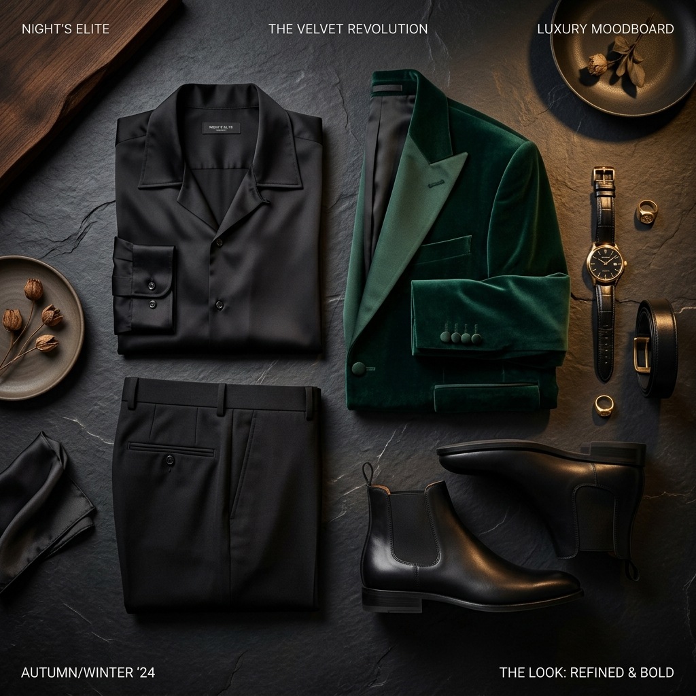

# 🎨 ChromaCloset
### Color Theory & Scenario Wardrobe Stylist
ChromaCloset is a browser-based wardrobe assistant that uses **real color science** to generate harmonious outfit combinations for any occasion — from Night Parties to Executive Boardrooms.
No AI API keys. No backend. Just pure color theory, running entirely in your browser.
> ⚡ **Vibe Coded** — This entire app was built through AI-assisted vibe coding sessions. The logic, design, and color engine were all shaped through prompting and iteration rather than traditional engineering. It works, it's fun, but it's very much a work-in-progress — so feedback is very welcome!

---
## ✨ Features
- **🍸 Scenario Stylist Studio** — Pick an occasion (Night Party, Romantic Date, Business Formal, Casual, Summer, Autumn) and get ranked outfit suggestions tailored to that vibe
- **🎨 Color Harmony Engine** — Scientifically evaluates outfits using Complementary, Analogous, Monochromatic, and Neutral Anchor color theory rules
- **📊 60-30-10 Proportion Rule** — Visual bar shows dominant / secondary / accent color balance like a real stylist would
- **🧭 Interactive Color Wheel** — Plots your outfit's colors on a 12-tone hue wheel showing geometric harmony chords
- **🔒 Anchor Piece Lock** — Lock any garment and generate all outfits built around it
- **👔 Wardrobe Manager** — Add, remove, and manage your closet with custom colors, fabrics, and formality levels
- **🧪 Live Color Synergy Tester** — Test any 3 colors in real-time and get an instant harmony score
- **📖 Personal Lookbook** — Save your favorite outfits for quick reference
- **🔊 Audio Haptics** — Subtle sound feedback on interactions (toggleable)
---
## 🚀 Getting Started
No installation required. Just open the file in your browser:
1. Clone or download this repository
2. Open `index.html` in any modern browser
3. That's it — no build step, no server needed!


```bash
git clone https://github.com/VathilaHerath/chromacloset.git
cd chromacloset
# Open index.html in your browser

```

🧠 How the Color Engine Works
ChromaCloset's color-engine.js implements a full sartorial color science pipeline:

Step	What Happens
Hex → HSL	Converts garment colors to Hue, Saturation, Lightness space
Neutral Detection	Identifies fashion neutrals (black, white, navy, camel, gray, olive)
Pairwise Harmony	Scores every garment pair using hue wheel distance rules
60-30-10 Analysis	Measures dominant/secondary/accent proportion balance
Scenario Bonus	Applies context-specific scoring (e.g., dark tones score higher for Night Party)
Outfit Ranking	Sorts all valid combinations by total harmony score

📁 Project Structure

chromacloset/
├── index.html          # Main app
├── style.css           # Full design system & animations
├── app.js              # Application logic & UI controller
├── color-engine.js     # Color theory & harmony scoring engine
├── wardrobe-data.js    # Wardrobe store with 28 curated starter pieces
└── assets/
    └── night_party_editorial.png

🎭 Scenarios Supported
Scenario and Vibe
🍸 Night Party & Club - Sleek dark foundations, bold accents, high contrast
🍷 Romantic Date - Warm rich undertones, tailored elegance
💼 Executive & Business	 - Crisp neutrals, strict 60-30-10 discipline
☕ Casual Weekend - Earth tones, relaxed layering
☀️ Summer Festival	- Light pastels, breezy open hues
🍂 Autumn Layering	- Camel, rust, heritage warmth

🛠️ Tech Stack
Pure HTML5, CSS3, Vanilla JavaScript — zero dependencies, zero frameworks
Web Audio API — for subtle sound haptics
SVG — all garment icons and color wheels rendered in-browser
localStorage — wardrobe and saved looks persist across sessions

💬 Feedback & Suggestions
This project was vibe coded — built through AI-assisted prompting and iteration. It's a passion project, not a polished product, so there are definitely rough edges! I made this project because I always struggle with finding matching clothes to wear. So if you have felt the same, I hope this would help.

If you try it out, I'd genuinely love to hear:

🐛 Bugs — anything broken or behaving weirdly?
🎨 Design feedback — does it look good? What feels off?
🧠 Feature ideas — what would make this actually useful to you?
👔 Fashion accuracy — are the outfit suggestions actually good?
Feel free to open an issue or just leave a comment — all feedback is appreciated, no matter how small!

📄 License
MIT — free to use, remix, and build on.

Made with, color theory, and a lot of vibes.
